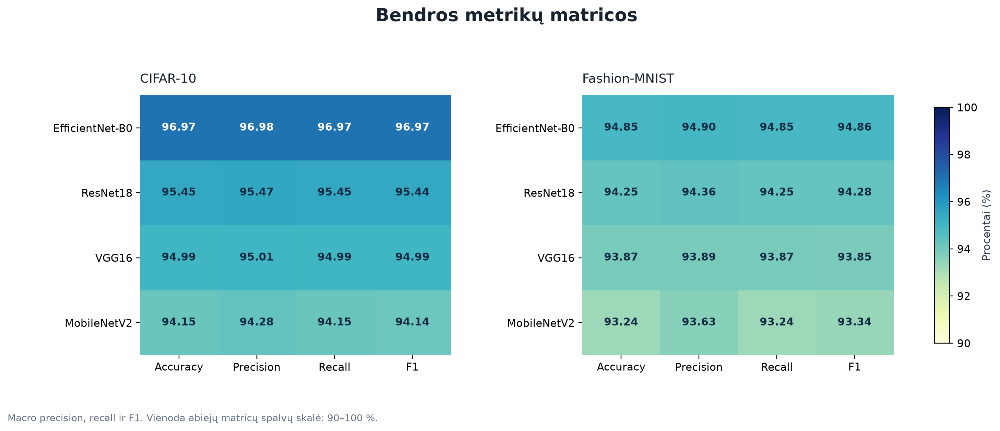

# kursinis

ResNet18 vaizdų klasifikavimas su CIFAR-10 ir Fashion-MNIST.

Bendras ResNet18, EfficientNet-B0, MobileNetV2 ir VGG16 palyginimas:
[`bendri_rezultatai/`](bendri_rezultatai/). Naršyklėje atidarykite
[`ataskaita.html`](bendri_rezultatai/ataskaita.html); ten yra bendra suvestinė
ir šešios visų modelių figūros. Grafikai pateikti PNG ir PDF formatais.
Visi grafikai viename dokumente: [bendras PDF](bendri_rezultatai/bendras_palyginimas.pdf).



Bloknotas: `ResNet18_CIFAR10_FashionMNIST.ipynb`.

[Atidaryti Google Colab](https://colab.research.google.com/drive/12k69aJ9cKVkqafPODgtR_zjz3A-EMWT7)
· [Projekto aplankas Drive](https://drive.google.com/drive/folders/1v5qIk_-Pk_XCP1uHBU5zzZQZAIsOvwxv)
· [GitHub](https://github.com/psych0navt/kursinis)

Atidarykite bloknotą Google Colab, pasirinkite **T4 GPU** ir paleiskite
**Runtime → Run all**. Pirmas langelis paprašys prijungti Google Drive.

Duomenys atsisiunčiami iš Hugging Face:

- [CIFAR-10](https://huggingface.co/datasets/uoft-cs/cifar10)
- [Fashion-MNIST](https://huggingface.co/datasets/zalando-datasets/fashion_mnist)

Drive aplankai:

```text
MyDrive/kursinis/
├── ResNet18_CIFAR10_FashionMNIST.ipynb
├── duomenys/       # NumPy duomenų kopijos, šaltiniai ir skaidymo indeksai
├── cache/          # Hugging Face podėlis ir ResNet18 ImageNet svoriai
├── rezultatai/     # PNG, CSV, JSON ir išmokytų modelių .pth failai
└── ResNet18_rezultatai.zip
```

Duomenys atsisiunčiami pirmo paleidimo metu. Kitose sesijose įkeliamos Drive
išsaugotos NumPy kopijos. Rezultatai sukuriami vykdant eksperimentus ir
iš karto rašomi į Drive. Į GitHub įkeliamas kodas, dokumentacija ir
eksperimentų rezultatai.

Naudojama 10 % validavimo dalis, `SEED=42`, 224×224 įvestis, paketai po 64,
3 epochos klasifikavimo galvai ir iki 10 epochų visam tinklui.
Ankstyvasis stabdymas taikomas pagal validavimo tikslumą, mokymosi tempas
mažinamas pagal validavimo nuostolį. Hugging Face vaizdų eilės tvarka gali
skirtis nuo kitų CIFAR-10 platinimo formatų; faktiniai skaidymo indeksai
išsaugomi Drive.
